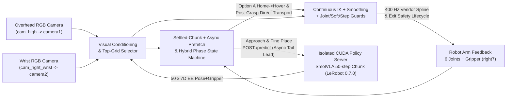

# `station-lite-LeRobot-v070-SmolVLA-RTC` (`v1.0`)

**Repository:** <https://github.com/aiorbits/station-lite-LeRobot-v070-SmolVLA-RTC>

A de-privatized **LeRobot `v0.7.0` + SmolVLA** tabletop manipulation repository (`v1.0`, **16 November 2026**) operating in single right-arm autonomous closed-loop mode (`right7`), spanning `0.6.2 -> 0.7.0` parity gates (`G0–G4`), Real-Time Chunking (RTC) vs. asynchronous HTTP `/predict` prefetching, hybrid fast-cycle control, and the full **Stage D0–D3 multi-object closed-loop supervised sorting & web panel stack (`src/v070_demo/`)**.

> [!IMPORTANT]
> **Weights, datasets, raw camera images, vendor SDK binaries, local paths, LAN IPs, and credentials are intentionally excluded.**
> Hardware execution and vendor SDK verification claims are strictly bounded in [Results & Reproducibility](docs/RESULTS_AND_REPRODUCIBILITY.md), with unexecuted post-edit hardware checks explicitly labeled **`NOT RUN`**.

## Latest Live Milestones (v1.0 — 16 November 2026)

1. **Multi-Object Closed-Loop Autonomous Sorting (`src/v070_demo/`, Stage D3)**:
   - **`r9` (`batch_8f2c1664`)**: First full **`3/3` autonomous pick-and-place completion (`108.218 s`, `0` interventions)** across Red (`R9`), Yellow (`R2`), and Blue (`R7`).
   - **`r12` (`batch_6f649714`)**: Validated `12.5 mm` active lift/transport clamping preload, aligned hover descent fallback on out-of-distribution edge cell `R1` (`obj_yellow_R1_1`), safe post-completion return to Home (`RETURNED_HOME_ON_COMPLETION`), and brown-pad interior 3-slot separation: **`3/3` in `110.644 s`, `0` interventions** (`obj_red_R3_1`, `obj_blue_R8_1`, `obj_yellow_R1_1`).
   - **Follow-up Update (Offline Verified, Live `r13` `NOT RUN`)**: Because `r12` used `heuristic_ease` (`R->B->Y`), `Scene 1` (`scene_1_standard`) now defaults to **`strict_order` (`Red -> Yellow -> Blue`)**, alongside continuous `Clear the table` replenishment loops and mid-air empty-slip recovery.
2. **Single-Block Hybrid Fast-Cycle Pilot (`station_lite_smolvla_right7_guarded.py`)**:
   - Four consecutive warmed-up yellow single-block trials (`3x R2`, `1x R8`): **`26.77–28.90 s`** strategy cycle (**`33.51–35.64 s`** including post-placement lift and exit Home), **`16/16` async prefetch hits**, and **`13/13` CAN-isolated SDK dry-run pass**.

| Measurement | Result |
| --- | --- |
| Multi-object Stage D3 autonomous sorting (`r9` / `r12`) | **`3/3` (`108.218 s` / `110.644 s`, `0` interventions)** |
| CAN-isolated vendor planning (`D2` / `D3` / Hybrid) | **`10/10` + `7/7` + `13/13` passed**, cleanup returned |
| Single-block Hybrid strategy cycle (`R2` / `R8`) | **`26.77–27.92 s`** (`R2`), **`28.90 s`** (`R8`) |
| Offline self-contained verification suite (`tests/`) | **`133/133` unit tests passed** (`87` core + `46` `v070_demo`) |

> Note: Startup readiness requires `/predict` warmup probes before hardware execution (`/health` alone did not establish inference readiness on Nov 16). See [Results & Reproducibility](docs/RESULTS_AND_REPRODUCIBILITY.md#3-latest-hybrid-optimizations-scheme-1--scheme-3--aerial-15x) for startup failure logs, `safe_hold_verified=false` scope bounds, and intermediate `r8`–`r11` multi-object diagnostics.

## Architecture Overview



## Key Technical Contributions

1. **`right7` Action-State Manifold Separation**:
   - Inputs: 7D `observation.state` (6 measured right joints in rad + calibrated gripper width in m) + two `640x480` RGB cameras (`cam_high`, `cam_right_wrist`).
   - Outputs: 50-step chunks of 7D absolute end-effector pose (`x, y, z, rx, ry, rz`) + target gripper width (`0..0.085 m`).
   - Eliminated inactive left-arm degrees of freedom (`14D -> 7D`), resolving early closed-loop policy stagnation under a fixed **35-training / 10-holdout** demonstration split.
2. **Real-Time Chunking (RTC) Quantitative Study vs. Settled Async Prefetch & T3 Splicing**:
   - Benchmarked flow-matching Guided RTC (`RTCConfig`, `EXP` schedule) across `execution_delay = 2, 3`, `execution_horizon`, perturbation impulses/steps, and `NFE = 10..80`.
   - Explained why naive Guided RTC (`+53–57%` CUDA latency, seam discontinuities shifted past horizon `h`) was replaced in production by **`AsyncPredictClient`** (`tail_lead = 0.10 s` behind settled splines, **`19/20` v1 and `16/16` warmed-up Hybrid** hits on robot) and prepared **T3 mid-flight phase-aligned splicing** (`evaluate_async_splice_candidate`) behind strict age/tracking fail-safes. See [Methods & RTC Architecture](docs/METHODS_AND_RTC_ARCHITECTURE.md).
3. **Calibrated 3D Wrist Projection & Symmetric OBB Conditioning**:
   - Coupled pinhole ray-casting + 2x2 XY parallax Jacobian (`solve_wrist_xy_correction`), modulo-90° square OBB symmetrization (`_enrich_block_obb_geometry`) against gripper finger occlusion, and active finger preload (`compute_adaptive_preload_m`).
4. **LeRobot `0.6.2 -> 0.7.0` Migration & Hardware Torque-Drop Mitigation**:
   - Gate `G0–G4` verification including 3-stage vision sublayer bisection pinning `G2` numeric drift to `bfloat16` SigLIP SDPA/CUDA kernels (`vis_eager_fp32 rel_l2 = 0.00101` vs `0.02634` in `bfloat16`).
   - Mitigated vendor SDK torque-drop on process exit (`ArmController::cleanup() -> Startouch::disable_all()`) with low-Z/held-object `go_home()` suppression, post-placement vertical lift, and `confirm_before_disable` hold pauses. See [Migration & Safety Gates](docs/MIGRATION_AND_SAFETY_GATES.md).
5. **Hybrid Deterministic + VLA Fast-Cycle Pipeline (Implemented Nov 13; Live Pilot Nov 16)**:
   - Combines **Option A** direct Home-to-Hover takeoff, halved settle timing (`0.10 s + 0.10 s`), **`1.5x` pure-aerial pre-grasp speed** (`0.36`), **Scheme 1** 2-stage geometric direct transport to brown-pad hover (skipping Chunk 4 `/predict`), and **Scheme 3** placement release-tail compression (`trim_release_tail`).

## Milestone & Validation Status Matrix

| Milestone Stage | Host / CUDA Verified | CAN-Isolated SDK Dry-Run (`unshare --net`) | Live Robot Closed-Loop |
| --- | --- | --- | --- |
| **`new9` Frozen Baseline (`LeRobot 0.6.2`)** | Passed (`65` plans audited, `0` violations) | Passed | **Passed (`8/8` live trials)** |
| **`LeRobot 0.7.0` Port (`G0–G4` Parity)** | Passed (`G1–G4`, `bfloat16` Option 1 signed off) | Passed (`11/11` v0.7.0 cases) | Included in Fast-Cycle v1 below |
| **Fast-Cycle v1 (Async Prefetch + Halved Settle + Option A + Trim)** | Passed (`66` contract + `13` opt tests) | **Passed (`11/11`)** | **Passed (`4/4` live trials; `30.2–32.2 s`)** |
| **Latest Hybrid (Scheme 1 Direct Transport + Scheme 3 Release Trim + Aerial 1.5x)** | **Passed** (host gates and offline tests) | **Passed (`13/13`, Nov 16)** | **4/4 warmed-up trials; `26.77–28.90 s` strategy cycle** |
| **Multi-Object Orchestrator (`src/v070_demo/`, Stage D0–D3)** | **Passed (`46/46` D0–D3 tests)** | **Passed (`10/10` D2 + `7/7` D3)** | **`3/3` in `r9` (`108.218 s`) & `r12` (`110.644 s`); `r13` `strict_order` `NOT RUN`** |
| **T3 Continuous Mid-Flight Splicing / Live Guided RTC / Stage D4–D5** | Unit-tested (`evaluate_async_splice_candidate`) | **`NOT RUN`** | **`NOT RUN`** |

## Remaining Scope

`r13` live hardware verification of `Scene 1` `strict_order` (`Red -> Yellow -> Blue`), matched same-session G5 A/B trials, rotated/distractor scenes, continuous T3 mid-flight splicing, live Guided RTC, Stage D4 mid-approach switching, Stage D5, external VLM planning, and Lego sorting remain **`NOT RUN`**.

## Repository Structure

```text
station-lite-LeRobot-v070-SmolVLA-RTC/
├── README.md                                  # Project overview & v1.0 milestone matrix
├── EXPORT_MANIFEST.json                       # SHA-256 & byte audit of every file
├── docs/
│   ├── METHODS_AND_RTC_ARCHITECTURE.md        # Deep dive: RTC, Async Prefetch, T3, Vision & Hybrid control
│   ├── MIGRATION_AND_SAFETY_GATES.md          # LeRobot 0.6.2 -> 0.7.0 G0-G4 gates & SDK lifecycle safety
│   ├── RESULTS_AND_REPRODUCIBILITY.md         # Verified empirical benchmarks, Stage D3 logs & training recipe
│   └── DEPLOYMENT_GUIDE.md                    # Sanitized env-var deployment, D3 dry-run & panel commands
├── manifests/
│   ├── environment_snapshot.json              # Package versions for v0.6.2 & v0.7.0 CUDA stacks
│   ├── runtime_profile.json                   # Approved right7 control/guard profile parameters
│   ├── live_hybrid_20261116_summary.json      # Sanitized single-block Hybrid pilot evidence summary
│   └── live_multiblock_20261116_summary.json  # Sanitized Stage D3 multi-object live evidence summary
├── src/
│   ├── build_grasp_replay_cases.py            # 3D wrist pinhole math, OBB conditioning, Option A & Scheme 1/3
│   ├── station_lite_smolvla_right7_guarded.py # AsyncPredictClient, T3 splice evaluators, guards & lifecycle
│   ├── station_lite_smolvla_right7_server.py  # Isolated CUDA-only HTTP inference service
│   ├── station_lite_smolvla_single_chunk.py   # Kinematic FK/IK retreat & chunk target validators
│   ├── joint_trace.py / analyze_joint_trace.py# High-rate joint logging & discontinuity diagnostics
│   ├── g3_http_compatibility_gate.py          # Isolated HTTP contract & stale-response probe suite
│   ├── g4_execution_adapter_gate.py           # Adapter parity, fast-cycle bundle & fault-injection suite
│   ├── g4_sdk_dryrun_gate.py                  # CAN-isolated (`unshare --net`) vendor planner verifier
│   ├── v070_common.py                         # SO(3) geodesic math & offline cache validators
│   ├── v070_demo/                             # Stage D0-D3 multi-object closed-loop panel & live orchestrator
│   ├── training/                              # 14D->7D dataset converter, standard & training launcher
│   └── rtc_analysis/                          # Offline CUDA Guided RTC & NFE perturbation benchmarks
└── tests/                                     # Self-contained offline unit test suite (133 tests)
```

## Quick Offline Verification

All offline safety guards, HTTP contract checks, asynchronous prefetch/fault-injection logic, hybrid conditioning math, multi-object session state machine/recovery/sequencing checks, and synthetic SDK dry-run checks can be verified without GPUs or robot hardware:

```bash
git clone https://github.com/aiorbits/station-lite-LeRobot-v070-SmolVLA-RTC.git
cd station-lite-LeRobot-v070-SmolVLA-RTC
python3 -m unittest discover -s tests -v
```

