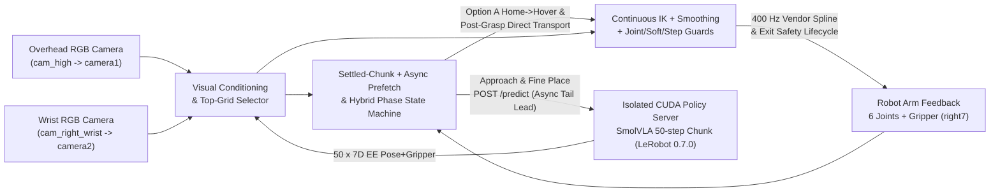

# `station-lite-LeRobot-v070-SmolVLA-RTC`

**Repository:** <https://github.com/aiorbits/station-lite-LeRobot-v070-SmolVLA-RTC>

A de-privatized **LeRobot `v0.7.0` + SmolVLA** tabletop manipulation repository running in single right-arm autonomous closed-loop mode (`right7`), migrated from LeRobot `0.6.2` to `0.7.0` with parity gates (`G0–G4`), Real-Time Chunking (RTC) vs. asynchronous HTTP `/predict` prefetching, T3 phase-aligned splicing infrastructure, calibrated 3D wrist vision conditioning, and hybrid fast-cycle control.

> [!IMPORTANT]
> **Weights, datasets, raw camera images, vendor SDK binaries, local paths, LAN IPs, and credentials are intentionally excluded.**
> Hardware execution and vendor SDK verification claims are strictly bounded in [Results & Reproducibility](docs/RESULTS_AND_REPRODUCIBILITY.md), with unexecuted hardware tests explicitly labeled **`NOT RUN`**.

## Latest Live Milestone — 16 November 2026

**The latest Hybrid configuration completed four consecutive warmed-up single-block pick-and-place trials: three at R2 and one at R8.** All four completed six chunks, confirmed release, performed the post-placement vertical lift, and returned Home. The operator reported successful physical grasp and placement.

| Measurement | Result |
| --- | --- |
| CAN-isolated vendor planning | **13/13 passed**, cleanup returned |
| R2 strategy cycle (3 trials) | **26.77–27.92 s** |
| R8 strategy cycle (1 trial) | **28.90 s** |
| Including post-placement lift and exit Home | **33.51–35.64 s** |
| Async prefetch, four warmed-up trials | **16/16 hits** |

These are small-sample system results on yellow single blocks, not a matched A/B reliability benchmark or an isolated measure of LeRobot/RTC acceleration. The earlier 20–24 s projection was not achieved in this batch. Camera-readiness failures, a health-request timeout, and a cold-start stale-observation rejection preceded the successful sequence and are retained in the [full results](docs/RESULTS_AND_REPRODUCIBILITY.md#3-latest-hybrid-optimizations-scheme-1--scheme-3--aerial-15x). **Warm up `/predict` before robot execution; `/health` alone did not establish inference readiness.**

## Architecture Overview



## Key Technical Contributions

1. **`right7` Action-State Manifold Separation**:
   - Inputs: 7D `observation.state` (6 measured right joints in rad + calibrated gripper width in m) + two `640x480` RGB cameras (`cam_high`, `cam_right_wrist`).
   - Outputs: 50-step chunks of 7D absolute end-effector pose (`x, y, z, rx, ry, rz`) + target gripper width (`0..0.085 m`).
   - Eliminated inactive left-arm degrees of freedom (`14D -> 7D`), resolving early closed-loop policy stagnation under a fixed **35-training / 10-holdout** demonstration split.
2. **Real-Time Chunking (RTC) Quantitative Study vs. Settled Async Prefetch & T3 Splicing**:
   - Benchmarked flow-matching Guided RTC (`RTCConfig`, `EXP` schedule) across `execution_delay = 2, 3`, `execution_horizon`, perturbation impulses/steps, and `NFE = 10..80`.
   - Explained why naive Guided RTC (`+53–57%` CUDA latency, seam discontinuities shifted past horizon `h`) was replaced in production by **`AsyncPredictClient`** (`tail_lead = 0.10 s` behind settled splines, **`19/20` v1 and `16/16` warmed-up Hybrid** hits on robot) and prepared **T3 mid-flight phase-aligned splicing** (`evaluate_async_splice_candidate`) behind strict age/tracking fail-safes. See [Methods & RTC Architecture](docs/METHODS_AND_RTC_ARCHITECTURE.md).
3. **Calibrated 3D Wrist Projection & Symmetric OBB Conditioning**:
   - Coupled pinhole ray-casting + 2x2 XY parallax Jacobian (`solve_wrist_xy_correction`), modulo-90° square OBB symmetrization (`_enrich_block_obb_geometry`) against gripper finger occlusion, and active finger preload (`compute_adaptive_preload_m`).
4. **LeRobot `0.6.2 -> 0.7.0` Migration & Hardware Torque-Drop Mitigation**:
   - Gate `G0–G4` verification including 3-stage vision sublayer bisection pinning `G2` numeric drift to `bfloat16` SigLIP SDPA/CUDA kernels (`vis_eager_fp32 rel_l2 = 0.00101` vs `0.02634` in `bfloat16`).
   - Mitigated vendor SDK torque-drop on process exit (`ArmController::cleanup() -> Startouch::disable_all()`) with low-Z/held-object `go_home()` suppression, post-placement vertical lift, and `confirm_before_disable` hold pauses. See [Migration & Safety Gates](docs/MIGRATION_AND_SAFETY_GATES.md).
5. **Hybrid Deterministic + VLA Fast-Cycle Pipeline (Implemented Nov 13; Live Pilot Nov 16)**:
   - Combines **Option A** direct Home-to-Hover takeoff, halved settle timing (`0.10 s + 0.10 s`), **`1.5x` pure-aerial pre-grasp speed** (`0.36`), **Scheme 1** 2-stage geometric direct transport to brown-pad hover (skipping Chunk 4 `/predict`), and **Scheme 3** placement release-tail compression (`trim_release_tail`).

## Milestone & Validation Status Matrix

| Milestone Stage | Host / CUDA Verified | CAN-Isolated SDK Dry-Run (`unshare --net`) | Live Robot Closed-Loop |
| --- | --- | --- | --- |
| **`new9` Frozen Baseline (`LeRobot 0.6.2`)** | Passed (`65` plans audited, `0` violations) | Passed | **Passed (`8/8` live trials)** |
| **`LeRobot 0.7.0` Port (`G0–G4` Parity)** | Passed (`G1–G4`, `bfloat16` Option 1 signed off) | Passed (`11/11` v0.7.0 cases) | Included in Fast-Cycle v1 below |
| **Fast-Cycle v1 (Async Prefetch + Halved Settle + Option A + Trim)** | Passed (`66` contract + `13` opt tests) | **Passed (`11/11`)** | **Passed (`4/4` live trials; `30.2–32.2 s`)** |
| **Latest Hybrid (Scheme 1 Direct Transport + Scheme 3 Release Trim + Aerial 1.5x)** | **Passed** (host gates and offline tests) | **Passed (`13/13`, Nov 16)** | **4/4 warmed-up trials; `26.77–28.90 s` strategy cycle** |
| **T3 Continuous Mid-Flight Splicing / Live Guided RTC** | Unit-tested (`evaluate_async_splice_candidate`) | **`NOT RUN`** | **`NOT RUN`** |

## Remaining Scope

Matched same-session G5 A/B trials, rotated/distractor scenes, continuous T3 mid-flight splicing, and live Guided RTC remain **NOT RUN**. The three-object session panel has a separate **D0–D1 mock implementation (18 reported tests passed)**; it is not shipped in this source bundle and has not been connected to the real executor. D2–D5, real multi-object recovery, external VLM planning, and Lego sorting remain future validation work.

## Repository Structure

```text
station-lite-LeRobot-v070-SmolVLA-RTC/
├── README.md                                  # Project overview & milestone matrix
├── EXPORT_MANIFEST.json                       # SHA-256 & byte audit of every file
├── docs/
│   ├── METHODS_AND_RTC_ARCHITECTURE.md        # Deep dive: RTC, Async Prefetch, T3, Vision & Hybrid control
│   ├── MIGRATION_AND_SAFETY_GATES.md          # LeRobot 0.6.2 -> 0.7.0 G0-G4 gates & SDK lifecycle safety
│   ├── RESULTS_AND_REPRODUCIBILITY.md         # Verified empirical benchmarks & training/eval recipe
│   └── DEPLOYMENT_GUIDE.md                    # Sanitized env-var deployment & dry-run commands
├── manifests/
│   ├── environment_snapshot.json              # Package versions for v0.6.2 & v0.7.0 CUDA stacks
│   └── runtime_profile.json                   # Approved right7 control/guard profile parameters
├── src/
│   ├── build_grasp_replay_cases.py            # 3D wrist pinhole math, OBB conditioning, Option A & Scheme 1/3
│   ├── station_lite_smolvla_right7_guarded.py # AsyncPredictClient, T3 splice evaluators, guards & lifecycle
│   ├── station_lite_smolvla_right7_server.py  # Isolated CUDA-only HTTP inference service
│   ├── station_lite_smolvla_single_chunk.py   # Kinematic FK/IK retreat & chunk target validators
│   ├── joint_trace.py / analyze_joint_trace.py# High-rate joint logging & discontinuity diagnostics
│   ├── g3_http_compatibility_gate.py          # Isolated HTTP contract & stale-response probe suite
│   ├── g4_execution_adapter_gate.py           # Adapter parity, fast-cycle bundle & fault-injection suite
│   ├── g4_sdk_dryrun_gate.py                  # CAN-isolated (`unshare --net`) vendor planner verifier
│   ├── v070_common.py                         # SO(3) geodesic math & offline cache validators
│   ├── training/                              # 14D->7D dataset converter, standard & training launcher
│   └── rtc_analysis/                          # Offline CUDA Guided RTC & NFE perturbation benchmarks
└── tests/                                     # Self-contained offline unit test suite (`unittest`)
```

## Quick Offline Verification

All offline safety guards, HTTP contract checks, asynchronous prefetch/fault-injection logic, hybrid conditioning math, and synthetic SDK dry-run checks can be verified without GPUs or robot hardware:

```bash
git clone https://github.com/aiorbits/station-lite-LeRobot-v070-SmolVLA-RTC.git
cd station-lite-LeRobot-v070-SmolVLA-RTC
python3 -m unittest discover -s tests -v
```

