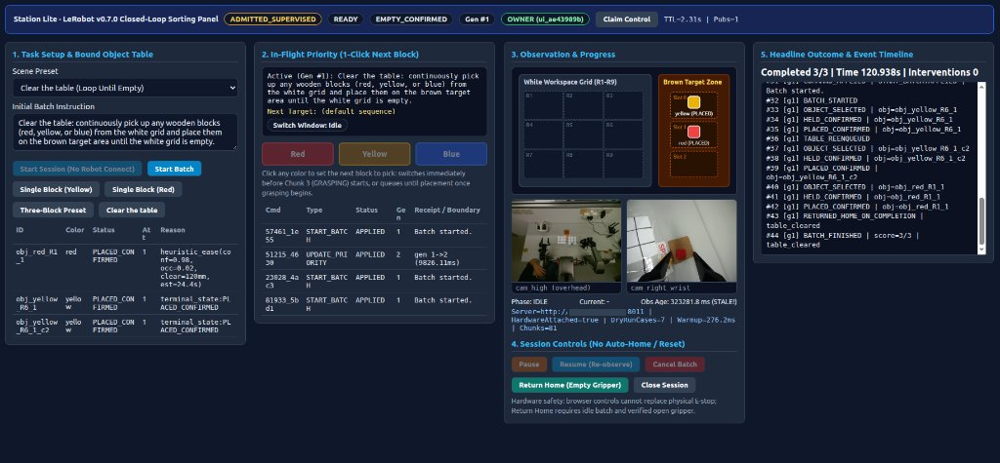
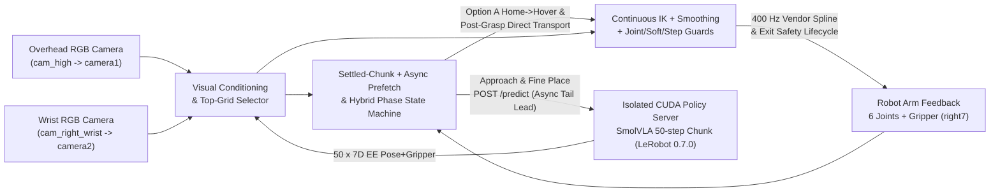

# `station-lite-LeRobot-v070-SmolVLA-RTC` (`v1.1`)

**Repository:** <https://github.com/aiorbits/station-lite-LeRobot-v070-SmolVLA-RTC>

A de-privatized **LeRobot `v0.7.0` + SmolVLA** autonomous dual-arm workstation repository (`v1.1`, **17 November 2026**) operating in right-arm closed-loop sorting mode (`right7`), spanning `0.6.2 -> 0.7.0` parity gates (`G0–G4`), Real-Time Chunking (RTC) vs. asynchronous HTTP `/predict` prefetching, Hybrid fast-cycle control, and the interactive **Stage D0–D3 Multi-Object Closed-Loop Supervised Web Panel (`src/v070_demo/`)**.

> [!IMPORTANT]
> **Weights, datasets, raw camera captures, vendor SDK binaries, local paths, LAN IPs, and credentials are excluded** (only sanitized UI screenshots under `docs/assets/` are committed with server IPs redacted).
> Hardware execution and SDK verification claims are strictly bounded in [Results & Reproducibility](docs/RESULTS_AND_REPRODUCIBILITY.md), with unexecuted post-edit hardware checks labeled **`NOT RUN`**.

## Project Highlights

- **Single-Arm `right7` Closed-Loop Manipulation on LeRobot `v0.7.0`**: Cleanly separates the active right arm (6 measured joints + calibrated gripper feedback -> 7D absolute EE pose + gripper target chunks) from inactive left-arm degrees of freedom (`14D -> 7D`), paired with calibrated dual-camera RGB conditioning (`cam_high`, `cam_right_wrist`) and square-symmetry OBB matching.
- **Deterministic + Async VLA Hybrid Fast-Cycle Execution**: Combines Option A direct Home->Hover takeoff, halved settle waits (`0.10 s + 0.10 s`), `1.5x` pure-aerial speed, Scheme 1 geometric post-grasp transport, Scheme 3 release-tail compression, and `AsyncPredictClient` settled prefetching (`26.77–28.90 s` single-block strategy cycles).
- **Interactive Multi-Object Supervised Web Panel (`src/v070_demo/`, Stage D0–D3)**:
  - **Dual Scene Modes**: Deterministic **`Scene 1` (`strict_order`: Red -> Yellow -> Blue)** and continuous **`Clear the table` (`TABLE_REENQUEUED` replenishment loop)**.
  - **1-Click In-Flight Priority Switching (`Red` / `Yellow` / `Blue`) with Chunk-3 (`GRASPING`) Safety Boundary**: Live **Switch Window** indicator automatically distinguishes **`PRE_GRASP_IMMEDIATE`** (preempts cleanly before Chunk 3 `GRASPING` starts and lifts open gripper to hover) vs. **`HOLDING_QUEUED_NEXT`** (queues cleanly until post-placement settle once Chunk 3+ grasp closure has started).
  - **Calibrated 3x3 Workspace Observation View & Live Cameras**: Accurate **`White Workspace Grid (R1–R9)`** and **`Brown Target Zone (Slot 0–2)`** SVG mapping, live `cam_high` + `cam_right_wrist` streams, and deduplicated structured event timeline.
  - **Fail-Closed Safety & Lifecycle Protection**: Mandatory CAN-isolated SDK dry-run admission (`unshare --net`), stale-observation age bounds (`<= 800 ms`), dual visual + gripper grasp/release confirmation, torque-drop hold pauses, and guarded **`Return Home (Empty Gripper)`** (`>= 45 mm` open verification + low-Z vertical lift before `go_home()`).



*Live v1.1 supervised panel capture (`r14`, `batch_e88cd039`, LAN server IP redacted): 3x3 `R1–R9` grid & brown `Slot 0–2` view, 1-click priority controls, `Return Home (Empty Gripper)`, and `Completed 3/3 | Time 120.938s | Interventions 0` with `RETURNED_HOME_ON_COMPLETION`.*

---

## Latest Verified Live Results (`v1.1` — 17 November 2026)

1. **Multi-Object Closed-Loop Autonomous Sorting (`src/v070_demo/`, Stage D3)**:
   - **`v1.1` Live Panel & Sequencing Runs (`r13` & `r14`, Nov 17)**:
     - **`Scene 1` Strict Order (`r14`, `batch_32f4b3aa`)**: Picked & placed strictly in **`Red (R4) -> Yellow (R8) -> Blue (R3)`** text order — **`3/3` in `118.744 s`, `0` interventions**, `RETURNED_HOME_ON_COMPLETION`.
     - **1-Click In-Flight Priority Override (`r13` `batch_da8e4b5c` & `r14` `batch_a9f597a2`)**: Triggered **`Blue`** priority mid-batch during `PLACING` (`HOLDING_QUEUED_NEXT`); atomically bumped to `Gen 2` after empty-hand checkpoint (`5.50 s` / `9.83 s` switch latency) and completed **`Red -> Blue -> Yellow`** — **`3/3` in `113.603 s` and `118.582 s`, `0` interventions**, `RETURNED_HOME_ON_COMPLETION`.
     - **`Clear the table` Continuous Replenishment (`r14`, `batch_e88cd039`)**: Completed **`Yellow (R6) -> TABLE_REENQUEUED -> Yellow (R6_c2) -> Red (R1)`** — **`3/3` in `120.938 s`, `0` interventions**, `RETURNED_HOME_ON_COMPLETION`.
     - **`r13` Safe Hold Observation (`batch_d0c27c84`)**: Confirmed `Red -> Yellow` (`2/3`), then halted safely in `PAUSED` when the 3rd block triggered `placement_unconfirmed` (suppressing blind auto-Home as designed), motivating the guarded **`Return Home (Empty Gripper)`** operator recovery button shipped in `v1.1`.
   - **`v1.0` Reference Runs (`r9` & `r12`, Nov 16)**: Initial `3/3` autonomous trials (`108.218 s` and `110.644 s`, `0` interventions).
2. **Single-Block Hybrid Fast-Cycle Pilot (`station_lite_smolvla_right7_guarded.py`)**:
   - Four consecutive warmed-up yellow single-block trials (`3x R2`, `1x R8`): **`26.77–28.90 s`** strategy cycle (**`33.51–35.64 s`** including post-placement lift and exit Home), **`16/16` async prefetch hits**, and **`13/13` CAN-isolated SDK dry-run pass**.

| Measurement | Result |
| --- | --- |
| `v1.1` `Scene 1` strict order (`r14`, `Red -> Yellow -> Blue`) | **`3/3` (`118.744 s`, `0` interventions, returned Home)** |
| `v1.1` In-flight priority override (`r13` / `r14`, -> `Blue`) | **`3/3` (`113.603 s` / `118.582 s`, `0` interventions)** |
| `v1.1` `Clear the table` loop (`r14`, `TABLE_REENQUEUED`) | **`3/3` (`120.938 s`, `0` interventions, returned Home)** |
| CAN-isolated vendor planning (`D2` / `D3` / Hybrid) | **`10/10` + `7/7` + `13/13` passed**, cleanup returned |
| Single-block Hybrid strategy cycle (`R2` / `R8`) | **`26.77–27.92 s`** (`R2`), **`28.90 s`** (`R8`) |
| Offline self-contained verification suite (`tests/`) | **`135/135` unit tests passed** (`87` core + `48` `v070_demo`) |

> Note: Startup readiness requires `/predict` warmup probes before hardware execution (`/health` alone did not establish inference readiness on Nov 16). While immediate pre-Chunk-3 (`APPROACHING_EMPTY` / `DESCENDING_CONTACT` -> safe hover -> `PREEMPTED_BEFORE_GRASP`) preemption is verified in offline unit test `test_26`, live `r13`/`r14` priority clicks occurred during `PLACING` (Chunk 3+ queue path). Live mid-approach pre-Chunk-3 click verification on hardware remains **`NOT RUN`**.

## Architecture Overview



## Key Technical Contributions

1. **`right7` Action-State Manifold Separation**:
   - Inputs: 7D `observation.state` (6 measured right joints in rad + calibrated gripper width in m) + two `640x480` RGB cameras (`cam_high`, `cam_right_wrist`).
   - Outputs: 50-step chunks of 7D absolute end-effector pose (`x, y, z, rx, ry, rz`) + target gripper width (`0..0.085 m`).
   - Eliminated inactive left-arm degrees of freedom (`14D -> 7D`) under a fixed **35-training / 10-holdout** demonstration split.
2. **Real-Time Chunking (RTC) Quantitative Study vs. Settled Async Prefetch & T3 Splicing**:
   - Benchmarked flow-matching Guided RTC (`RTCConfig`, `EXP` schedule) across `execution_delay = 2, 3`, `execution_horizon`, perturbation impulses/steps, and `NFE = 10..80`.
   - Replaced naive Guided RTC in production with **`AsyncPredictClient`** (`tail_lead = 0.10 s` behind settled splines, **`19/20` v1 and `16/16` warmed-up Hybrid** hits on robot) and prepared **T3 mid-flight phase-aligned splicing** (`evaluate_async_splice_candidate`) behind strict age/tracking fail-safes. See [Methods & RTC Architecture](docs/METHODS_AND_RTC_ARCHITECTURE.md).
3. **Calibrated 3D Wrist Projection & Symmetric OBB Conditioning**:
   - Coupled pinhole ray-casting + 2x2 XY parallax Jacobian (`solve_wrist_xy_correction`), modulo-90° square OBB symmetrization (`_enrich_block_obb_geometry`) against gripper finger occlusion, and active finger preload (`compute_adaptive_preload_m`).
4. **LeRobot `0.6.2 -> 0.7.0` Migration & Hardware Torque-Drop Mitigation**:
   - Gate `G0–G4` verification including 3-stage vision sublayer bisection pinning `G2` numeric drift to `bfloat16` SigLIP SDPA/CUDA kernels (`vis_eager_fp32 rel_l2 = 0.00101` vs `0.02634` in `bfloat16`).
   - Mitigated vendor SDK torque-drop on process exit (`ArmController::cleanup() -> Startouch::disable_all()`) with low-Z/held-object `go_home()` suppression, post-placement vertical lift, `confirm_before_disable` hold pauses, and guarded manual `Return Home (Empty Gripper)`. See [Migration & Safety Gates](docs/MIGRATION_AND_SAFETY_GATES.md).
5. **Hybrid Deterministic + VLA Fast-Cycle Pipeline**:
   - Combines **Option A** direct Home-to-Hover takeoff, halved settle timing (`0.10 s + 0.10 s`), **`1.5x` pure-aerial pre-grasp speed** (`0.36`), **Scheme 1** 2-stage geometric direct transport to brown-pad hover (skipping Chunk 4 `/predict`), and **Scheme 3** placement release-tail compression (`trim_release_tail`).

## Milestone & Validation Status Matrix

| Milestone Stage | Host / CUDA Verified | CAN-Isolated SDK Dry-Run (`unshare --net`) | Live Robot Closed-Loop |
| --- | --- | --- | --- |
| **`new9` Frozen Baseline (`LeRobot 0.6.2`)** | Passed (`65` plans audited, `0` violations) | Passed | **Passed (`8/8` live trials)** |
| **`LeRobot 0.7.0` Port (`G0–G4` Parity)** | Passed (`G1–G4`, `bfloat16` Option 1 signed off) | Passed (`11/11` v0.7.0 cases) | Included in Fast-Cycle v1 below |
| **Fast-Cycle v1 (Async Prefetch + Halved Settle + Option A + Trim)** | Passed (`66` contract + `13` opt tests) | **Passed (`11/11`)** | **Passed (`4/4` live trials; `30.2–32.2 s`)** |
| **Latest Hybrid (Scheme 1 Direct Transport + Scheme 3 Release Trim + Aerial 1.5x)** | **Passed** (host gates and offline tests) | **Passed (`13/13`, Nov 16)** | **4/4 warmed-up trials; `26.77–28.90 s` strategy cycle** |
| **Multi-Object Orchestrator (`src/v070_demo/`, Stage D0–D3, v1.1)** | **Passed (`48/48` D0–D3 tests)** | **Passed (`10/10` D2 + `7/7` D3)** | **`r9`/`r12` (`3/3`), `r13` priority (`3/3`), `r14` strict/priority/clear (`3/3` x 3)** |
| **Live Pre-Chunk-3 Click / T3 Splicing / Live Guided RTC / Stage D4–D5** | Unit-tested (`test_26`, `evaluate_async_splice_candidate`) | **`NOT RUN`** | **`NOT RUN`** |

## Remaining Scope

Live hardware pre-Chunk-3 priority clicks during `APPROACHING_EMPTY` / `DESCENDING_CONTACT` (only offline `test_26` verified), matched same-session G5 A/B trials, rotated/distractor scenes, continuous T3 mid-flight splicing, live Guided RTC, Stage D4 trajectory-cancel switching, Stage D5 full sweeps, external VLM planning, and Lego sorting remain **`NOT RUN`**.

## Repository Structure

```text
station-lite-LeRobot-v070-SmolVLA-RTC/
├── README.md                                  # Project highlights, v1.1 panel preview & milestone matrix
├── EXPORT_MANIFEST.json                       # SHA-256 & byte audit of every file
├── docs/
│   ├── assets/
│   │   └── panel_v1_1_clear_table.png         # Sanitized v1.1 live web panel UI screenshot
│   ├── DEPLOYMENT_GUIDE.md                    # Sanitized env-var deployment, D3 dry-run & panel commands
│   ├── METHODS_AND_RTC_ARCHITECTURE.md        # Deep dive: RTC, Async Prefetch, T3, Vision & Hybrid control
│   ├── MIGRATION_AND_SAFETY_GATES.md          # LeRobot 0.6.2 -> 0.7.0 G0-G4 gates & SDK lifecycle safety
│   └── RESULTS_AND_REPRODUCIBILITY.md         # Verified empirical benchmarks, Stage D3 v1.0-v1.1 logs
├── manifests/
│   ├── environment_snapshot.json              # Package versions for v0.6.2 & v0.7.0 CUDA stacks
│   ├── runtime_profile.json                   # Approved right7 control/guard profile parameters
│   ├── live_hybrid_20261116_summary.json      # Sanitized single-block Hybrid pilot evidence summary
│   ├── live_multiblock_20261116_summary.json  # Sanitized v1.0 Stage D3 multi-object summary
│   └── live_multiblock_20261117_summary.json  # Sanitized v1.1 Stage D3 live verification summary
├── src/
│   ├── build_grasp_replay_cases.py            # 3D wrist pinhole math, OBB conditioning, Option A & Scheme 1/3
│   ├── station_lite_smolvla_right7_guarded.py # AsyncPredictClient, T3 splice evaluators, guards & lifecycle
│   ├── station_lite_smolvla_right7_server.py  # Isolated CUDA-only HTTP inference service
│   ├── station_lite_smolvla_single_chunk.py   # Kinematic FK/IK retreat & chunk target validators
│   ├── joint_trace.py / analyze_joint_trace.py# High-rate joint logging & discontinuity diagnostics
│   ├── g3_http_compatibility_gate.py          # Isolated HTTP contract & stale-response probe suite
│   ├── g4_execution_adapter_gate.py           # Adapter parity, fast-cycle bundle & fault-injection suite
│   ├── g4_sdk_dryrun_gate.py                  # CAN-isolated (`unshare --net`) vendor planner verifier
│   ├── v070_common.py                         # SO(3) geodesic math & offline cache validators
│   ├── v070_demo/                             # Stage D0-D3 multi-object closed-loop panel & live orchestrator
│   ├── training/                              # 14D->7D dataset converter, standard & training launcher
│   └── rtc_analysis/                          # Offline CUDA Guided RTC & NFE perturbation benchmarks
└── tests/                                     # Self-contained offline unit test suite (135 tests)
```

## Quick Offline Verification

All offline safety guards, HTTP contract checks, asynchronous prefetch/fault-injection logic, hybrid conditioning math, multi-object session state machine/recovery/preemption/Return-Home checks, and synthetic SDK dry-run checks can be verified without GPUs or robot hardware:

```bash
git clone https://github.com/aiorbits/station-lite-LeRobot-v070-SmolVLA-RTC.git
cd station-lite-LeRobot-v070-SmolVLA-RTC
python3 -m unittest discover -s tests -v
```
