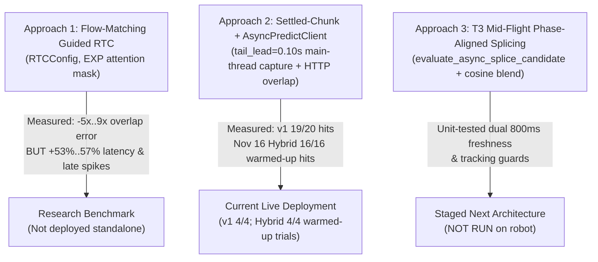

# Methods & Real-Time Chunking (RTC) Architecture

This document details the algorithmic design choices behind our dual-arm tabletop manipulation policy operating in `right7` mode, focusing on **action-chunk handoff (Guided RTC vs. Settled-Chunk Asynchronous Prefetch vs. T3 Mid-Flight Splicing)**, **calibrated visual conditioning**, and **hybrid deterministic-VLA execution**.

---

## 1. Action-State Contract (`right7`)

Early experiments trained a 14D bimanual SmolVLA policy where left-arm joints remained nearly stationary while the right arm manipulated blocks. Under small-sample imitation (`35` training demonstrations, `10` holdout demonstrations), inactive left-arm dimensions diluted gradients and produced closed-loop plateauing.

Isolating the active right arm into `right7` (`src/training/convert_right_only_dataset.py`) resolved the capacity split cleanly:
- **Observation State (7D)**: `[q1, q2, q3, q4, q5, q6, gripper_m]`, where `q1..q6` are measured right-arm joint positions (rad) and `gripper_m` is calibrated physical finger opening (`states.right_gripper[0] / (1.5 * (0.046 / 0.117))`).
- **Action Chunk (`50 x 7`)**: 6D absolute end-effector Cartesian targets (`x, y, z` in meters; extrinsic `'xyz'` Euler `rx, ry, rz` in radians) plus commanded gripper opening (`0.0..0.085 m`, `GRIPPER_MAX_M = 0.085`).
- **Cameras (`640x480` RGB)**: Overhead scene view (`cam_high -> camera1`) and eye-in-hand wrist view (`cam_right_wrist -> camera2`), resized with padding to `512x512` inside SmolVLA while leaving `camera3` unpopulated.

---

## 2. Action-Chunk Handoff: Guided RTC vs. Async Settled Prefetch vs. T3 Splicing

Deploying flow-matching Vision-Language-Action (VLA) models on physical hardware requires bridging a `130–280 ms` policy forward pass with continuous `30–400 Hz` robot trajectory control. We investigated and built three distinct chunk-handoff architectures:

### 2.1 Flow-Matching Guided RTC Evaluation (`src/rtc_analysis/`)

In flow-matching Guided RTC (`compare_guided_rtc.py` using LeRobot's `RTCConfig(enabled=True, mode='guided', prefix_attention_schedule=RTCAttentionSchedule.EXP)`), the denoising loop constrains the first `d = execution_delay` steps of the newly sampled chunk to stay consistent with the unexecuted tail of the previous chunk (`prev_chunk_left_over`), decaying guidance across `execution_horizon = h` with weight `w`.

We replayed saved live handoff observations on CUDA (`woodblock_20261027_v1`, `phase=10`, `n=3` seeds) and injected controlled `30 mm` prefix perturbations (`probe_rtc_perturb_nfe.py`):

| Policy Config (`delay=2`) | Prefix XYZ Mean Error (mm) | 1st Available Target Error (mm) | Handoff Seam Step (mm) | Future Max Step (mm) | Future Steps `>15 mm` | CUDA Latency (ms) |
| --- | ---: | ---: | ---: | ---: | ---: | ---: |
| `plain` (no RTC) | `21.348` | `16.222` | `15.995` | `34.065` | `2.0` | `180.815` |
| `rtc_h8_w10` | `14.712` | `2.924` | `8.909` | `32.716` | `1.0` | `283.419` |
| `rtc_h12_w10` | `8.262` | `2.128` | `8.196` | **`42.576`** | `1.0` | `276.604` |
| `rtc_h16_w10` | `6.258` | `1.689` | `7.836` | `37.815` | `1.0` | `278.584` |

At `delay=3`, `plain` produced a `17.746 mm` handoff seam jump while `rtc_h16_w10` reduced the immediate handoff step to `3.543 mm`, yet `future_max_step_mm` still increased to `39.356 mm` (vs. `34.065 mm` plain). Under a controlled `30 mm` perturbation (`seed=43, delay=2, h=8, w=10`):
- A single-step impulse perturbation at index `0` stayed localized (`delta_overlap_max_mm = 30.058`, `delta_nonoverlap_max_mm = 4.244`).
- A persistent step perturbation shifted the non-overlapping suffix (`delta_overlap_max_mm = 31.284`, `delta_nonoverlap_max_mm = 21.408`).
- Sweeping Euler denoising steps (`NFE = 10, 20, 40, 80`) yielded CUDA latencies of `200.8 / 343.6 / 654.1 / 1278.3 ms` with `6.742 / 3.113 / 1.134 / 0.0 mm` trajectory difference vs. the 80-NFE reference.

**Why Guided RTC Alone Was Insufficient for Production**:
1. **Compute Cost vs. Gain**: Differentiable guidance inside denoising increased inference latency by `+53% to +57%` (`180.8 ms -> 276.6–283.4 ms`), eating directly into the real-time overlap budget (`NFE = 10` already consumes `~134–181 ms` on RTX 4080 Laptop).
2. **Discontinuity Transfer**: Stronger overlap enforcement compresses the error at step `delay` (`16.2 -> 1.69 mm`) but frequently shifts a steep corrective kink past `execution_horizon` (`future_max_step_mm = 42.58 mm`).
3. **Spline Preemption Semantics**: The vendor arm planner (`plan_joint_waypoints_with_gripper` / `update_joint_waypoint_chunk_with_gripper`) synthesizes smooth `400 Hz` joint splines whose hardware execution timing must respect joint velocity/acceleration bounds (`<= 0.47 rad/s`, `<= 17.0 rad/s^2` audited); unguarded in-flight chunk overwrites risk physical drift unless paired with strict phase synchronization.
4. **Upstream Conditioning Remains Essential**: Guided RTC preserves continuity relative to the prior chunk, so it cannot repair camera/parallax offsets, gripper finger squeeze loss, or IK boundary violations.

### 2.2 Production Handoff: Settled Chunks + `AsyncPredictClient` Prefetch

To eliminate inference idle stalls *without* exposing hardware to unvalidated mid-spline overwrites, we split execution into discrete guarded chunks paired with **`AsyncPredictClient`** (`src/station_lite_smolvla_right7_guarded.py`):

1. **Single Main-Thread SDK Ownership**: Background threads never call vendor robot SDK APIs or ZMQ camera getters. Instead, the main thread captures fresh camera frames and joint/EE state `tail_lead = 0.10 s` before the chunk's stationary settle period completes, then submits HTTP `POST /predict` to an executor thread.
2. **Disk I/O Offloading (`AsyncSnapshotWriter`)**: JPEG/NPY/JSON diagnostic snapshots are queued off the critical path so disk serialization never blocks control transitions.
3. **Halved Settle Margin & Fail-Closed Drift Gates**:
   - Post-chunk drain margin (`--settle-margin-s 0.10`) + standstill verification sleep (`--settle-drift-sleep-s 0.10`, compressed 50% from `0.20 + 0.20 s`) verify joint drift `<= 0.01 rad`.
   - Before consuming a prefetched `/predict` result, the main thread verifies:
     - Observation age `<= 0.78 * max_observation_age_ms` (`800 ms` budget -> `624 ms` soft threshold during pre-consumption check),
     - Post-capture joint drift `<= 0.015 rad`,
     - Post-capture gripper drift `<= 0.008 m`,
     - Exact match of `session_id`, `seq`, and deterministic `sampling_seed`.
   - Any check failure discards the stale prediction and synchronously re-observes (`[ASYNC PREFETCH]`), ensuring safety degrades gracefully to synchronous settled inference.

Across live fast-cycle v1 robot trials, `AsyncPredictClient` achieved **19/20 (95%) prefetch hits**. On 16 November the latest Hybrid achieved **16/16 hits across four warmed-up trials**, with normal completion and no guard rejection in that warmed-up sequence. Startup failures and cold rejection are reported separately in [Results](RESULTS_AND_REPRODUCIBILITY.md); hit rate does not certify trajectory continuity or comprehensive recovery.

### 2.3 T3 Foundation: Mid-Flight Phase-Aligned Splicing (`evaluate_async_splice_candidate`)

For future asynchronous continuous execution (where a policy chunk—optionally generated with Guided RTC—is spliced *while the arm is still moving* without waiting for a full stop), we implemented and unit-tested the T3 gate in `src/station_lite_smolvla_right7_guarded.py`:
- **Disambiguated Phase Tracking (`time_consistent_waypoint_index`, `diagnose_phase_alignment`)**: Combines joint-space nearest waypoint (`measured_index`) with wall-clock progress (`clock_index`) so repeated/hover waypoints cannot trigger false early handoffs.
- **Adaptive Reserve (`adaptive_phase_reserve`) & Splice Synthesis (`build_phase_aligned_segment`)**: Estimates measured-vs-clock slip and blends the incoming prediction head smoothly with `blend_head(..., mode="cosine")`.
- **Dual-Stage Freshness & Tracking Guards (`observation_tracking_guard`, `evaluate_async_splice_candidate`)**: Checks observation age at both *splice planning/installation* and *physical controller activation* (`<= 800 ms`), rejecting if tracking error jumps (`> 0.06 rad`) or joints drift away from the planned phase.

*Status: Unit-tested in offline suites; live robot continuous mid-flight switching remains `NOT RUN` pending hardware `safe_hold` lifecycle certification.*

---

## 3. Calibrated 3D Wrist Vision & Decoupled State Conditioning (`src/build_grasp_replay_cases.py`)

Rather than relying on unconditioned raw 50-step SmolVLA outputs alone—which occasionally closed the gripper prematurely mid-air or suffered XY hover plateaus—each chunk passes through deterministic phase-specific geometric conditioning before IK:

1. **Overhead Global Grid Selection (`detect_high_cam_grid_target`)**:
   - Prompt color parsing (`parse_target_color`, supporting red, yellow, green, blue, cyan via unicode-safe matching) segments target block blobs on `cam_high` and selects the calibrated workspace cell (`R1..R9`, `GRID_HOVER_POSES`).
   - When planar distance to target cell exceeds `0.045 m` and `--fast-grid-approach` is active, far approach chunks jump directly to the calibrated hover coordinate instead of crawling incrementally.
2. **Pinhole 3D Projection & Parallax Compensation (`project_wrist_world_point`, `raycast_wrist_pixel_to_table`, `solve_wrist_xy_correction`)**:
   - Uses a jointly calibrated pinhole model for `cam_right_wrist` (`fx = 258.296`, `fy = 269.045`, `u0 = 320.0`, `v0 = 240.0`, table object plane `z = 0.0198019 m`, fixed `EE -> cam` transform `WRIST_CAM_R_EE_TO_CAM`, `WRIST_CAM_T_EE_TO_CAM_M = [0.044151, 0.005561, 0.099800] m`).
   - `wrist_target_uv_for_pose` projects canonical grasp center `(cx*, cy*)` from table grasp height (`0.160 m`) up to the current hover height (`0.182–0.200 m`), canceling Z-parallax errors in `dv` before computing world XY shifts via ray-plane intersection (with coupled `2x2` Jacobian fallback near R8).
3. **OBB Square Symmetrization (`_enrich_block_obb_geometry`, `select_grasp_orientation_candidate`)**:
   - Distinguishes square blocks (`aspect_ratio < 1.35`) from elongated blocks.
   - Because gripper jaws partially occlude blocks near close range, raw `cv2.minAreaRect` axes can flip by `90°`. Square OBBs use `grasp_axis_mode = "symmetric_square"` with modulo-90° folding (`((short_axis_deg + 45) % 90) - 45`, `18°` deadband) and temporal hysteresis (`prev_obb`), stabilizing yaw alignment before descent.
4. **Decoupled Descent & Active Finger Preload (`condition_grasp_actions`, `compute_adaptive_preload_m`)**:
   - Keeps the gripper open (`>= 0.075 m`) while aligning XY/yaw at hover and descending vertically only after alignment check (`tol = 20.0 px`).
   - During lift and transport, commands `clamp_grip = max(0.005, held_grip - preload_m)` (`preload_m = 0.008 m` adaptive) so the position-controlled gripper maintains firm squeeze torque against rigid wooden blocks.

---

## 4. Hybrid Deterministic + VLA Fast-Cycle Pipeline (Nov 13 Implementation; Nov 16 Live Pilot)

To minimize single pick-and-place cycle time while preserving closed-loop visual adaptability at grasp and fine placement, the latest pipeline combines learned VLA chunks with deterministic smooth segments where kinematics/geometry are known:

| Phase | Executor | Key Mechanism & Flags | Skip `/predict`? |
| --- | --- | --- | --- |
| **0. Home -> Hover Takeoff** | Deterministic (`condition_home_takeoff_actions`) | **Option A**: minimum-jerk-style sinusoidal aerial rise straight from `Home` to `detect_high_cam_grid_target()["hover_pose"]` (`hover_z_m=0.200`, `30–44` steps, `takeoff_speed=0.30`). | **Yes** |
| **1. Aerial Approach** | SmolVLA + Visual Servo | Pure aerial chunks (`min(z) >= max(0.176, hover_z_m - 0.012)`) execute at **`1.5x` speed** (`0.24 -> 0.36`, `--aerial-approach-speed 0.36`) with `--fast-grid-approach` & idle-tail trim. | No (`AsyncPrefetch`) |
| **2. Fine Hover & Grasp** | SmolVLA + Wrist OBB (`condition_approach_actions`, `condition_grasp_actions`) | Slower precision speed (`0.24`), `2.0 s` held grasp closure (`--grasp-duration-s 2.0`), followed by `held_grip` grasp confirmation & auto-retry (`--max-grasp-retries 1`). | No (`AsyncPrefetch`) |
| **3. Post-Grasp Transport** | **Scheme 1 Hybrid** (`condition_direct_transport_actions`) | **Stage 1**: vertical clearance lift (`z >= 0.208 m`) locking XY/RPY while ramping preload. **Stage 2**: cosine-blended lateral/orientation arc holding `z >= clear_z` over first `45%` of travel toward calibrated `BROWN_TARGET_HOVER_POSE6 = [0.348, 0.216, 0.193, -0.45, 0.90, 0.94]`. Fails closed (`[DIRECT TRANSPORT FALLBACK]`) back to SmolVLA Chunk 4 if IK/slip/step checks raise `ValueError`. | **Yes** (`will_skip_next_predict=True`) |
| **4. Visual Placement & Release** | SmolVLA + **Scheme 3** (`condition_placement_actions(..., trim_release_tail=True)`) | Final closed-loop brown-pad alignment & drop; compresses redundant post-release tail to `open_steps + 4` + idle-tail trimming (`keep_tail_hold=4`), followed by safe vertical Z lift before optional Home. | No |

Every deterministic and learned segment passes through the **identical continuous IK solver, 3-point zero-phase waypoint smoother (`smooth_joint_waypoints`, `alpha=0.20`), and post-smoothing joint/soft-limit validator (`validate_post_smoothing_waypoints`)** before reaching hardware.

The 16 November reference-station pilot confirmed direct transport durations of 2.333 s at R2 and 3.444 s at R8, followed by visual placement, post-placement lift and Home. Overall strategy time was 26.77–28.90 s. These are complete-system measurements; live Guided RTC and T3 mid-flight splicing were not enabled or validated by this batch.
